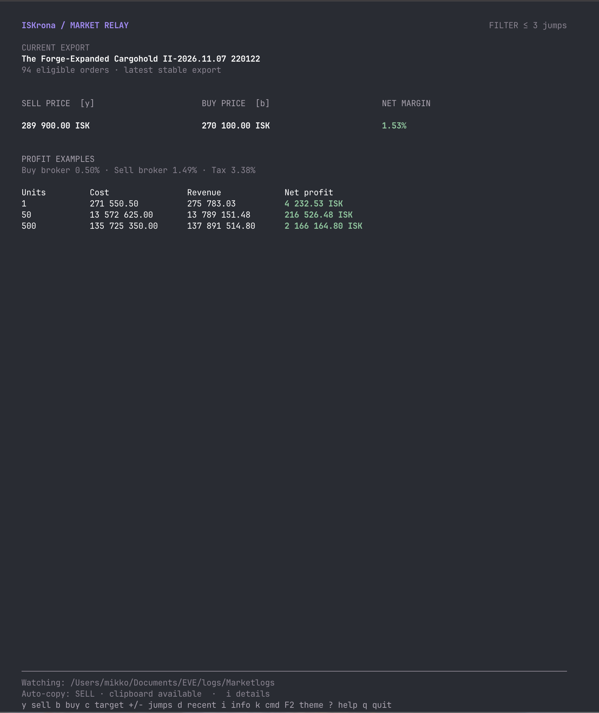

# ISKrona

ISKrona is a market assistant for EVE Online. It watches your market exports, recommends buy and sell prices, estimates profit after fees and tax, and can copy prices to the clipboard.

## Install

Download the [latest stable release](https://github.com/mekstrem/iskrona/releases/latest) for your operating system and CPU, extract it, and place the `iskrona` executable somewhere on your `PATH`. Releases are available for Windows, macOS, and Linux on amd64 and arm64.

The `master` branch may contain unreleased changes. To build a stable version from source, check out its release tag before building.

<details>
<summary>Install or uninstall with an AI agent</summary>

To install, give your agent this prompt:

```text
Install ISKrona from https://github.com/mekstrem/iskrona/releases/latest.
Download the archive for my operating system and CPU. Verify its SHA-256
against checksums.txt from the same release before extracting it. If no
matching archive is available, build from that release tag with Go 1.26
or later.

Install the executable in a user-writable directory on my PATH. Ask before
making privileged changes. Confirm that `iskrona` resolves to the installed
executable, then run `iskrona version`. For a prebuilt release, confirm the
version matches the release tag. For a source build, report the tag used
and the command's output; a plain source build may report `dev`.
```

To uninstall:

```text
Uninstall ISKrona from my computer. Find and remove its executable and any
PATH entry added specifically for it. Ask before making privileged changes or
removing my configuration or other user data. Verify the executable is no
longer available on my PATH.
```

</details>



## Quick start

1. Run `iskrona` in a terminal to open the Market Relay dashboard.
2. If Market Relay can't find your EVE `Marketlogs` folder, restart it with `iskrona --path "DIR"`, replacing `DIR` with the path to that folder.
3. With Market Relay running, open an item in the EVE market and use the market-export action to save a `.txt` export. The dashboard updates when the export is ready.

**[Read the user guide](docs/user-guide.md)** for configuration, EVE login and fees, clipboard settings, and troubleshooting.

| Shortcut | Action |
| --- | --- |
| `?` | Show shortcut help |
| `i` | Inspect trade costs |
| `c` | Copy the configured recommendation |
| `y` / `b` | Copy the best sell / buy price |
| `+` / `-` | Increase / decrease the jump limit |

## Contributing and support

Report bugs or request features in [GitHub Issues](https://github.com/mekstrem/iskrona/issues). See [Contributing](CONTRIBUTING.md) for source builds and developer setup, and read the [security policy](SECURITY.md) and [Code of Conduct](CODE_OF_CONDUCT.md) before participating.

You can support development with an optional in-game ISK donation to **Pleiadian Trading**, subject to [CCP’s Developer License Agreement](https://developers.eveonline.com/license-agreement).

## License and disclaimer

ISKrona is released under the [MIT License](LICENSE). It is an independent project and is not affiliated with, endorsed by, or sponsored by CCP Games. EVE Online and related marks are the property of CCP Games.
