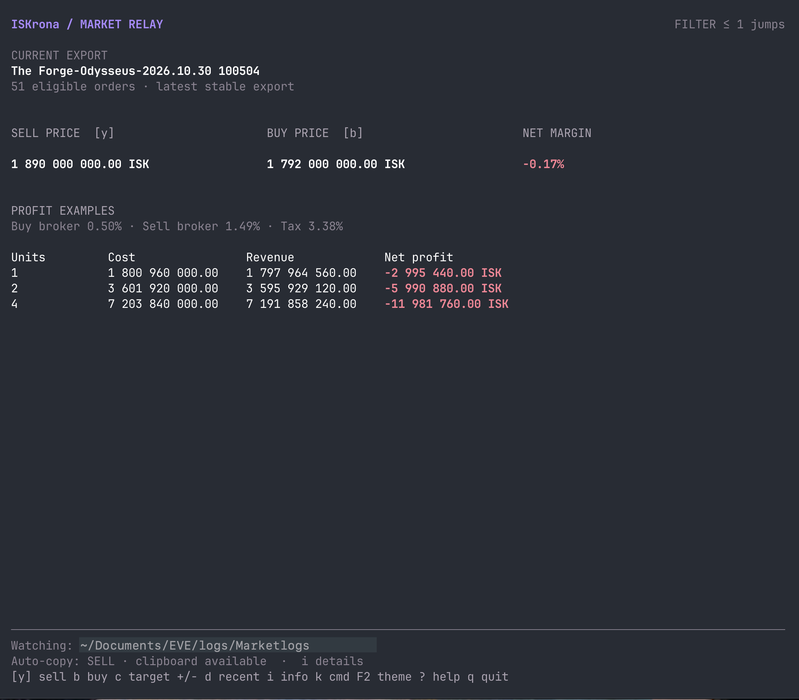
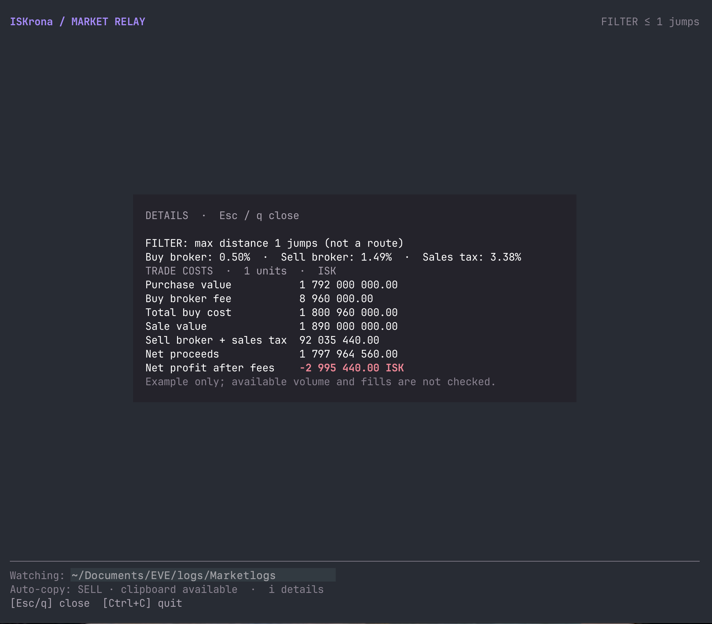

# ISKrona

ISKrona is a focused Go market assistant for EVE Online. It watches exported market data, turns the current order book into practical buy and sell recommendations, estimates margin, and can copy a recommendation to the clipboard.

## Install

Download the archive for your operating system and CPU from [Releases](../../releases), extract it, and place the `iskrona` executable somewhere on your `PATH`.

Alternatively, build from source with Go 1.26 or later:

```text
git clone https://github.com/mekstrem/iskrona.git
cd iskrona
go build ./cmd/iskrona
```

Alternatively, run `./build.sh` from the repository to build locally.

Prebuilt releases are available for Windows, macOS, and Linux on amd64 and arm64.

### AI installation

Give this prompt to your AI agent:

```text
Install ISKrona locally from https://github.com/mekstrem/iskrona.
Use the latest release for my operating system and CPU, or build from source
with Go 1.26 or later if needed. Put the executable on my PATH and verify the
installation with `iskrona version`. Ask before making privileged changes.
```

To uninstall, give your AI agent this prompt:

```text
Uninstall ISKrona from my computer. Find and remove its executable and any
PATH entry added specifically for it. Ask before making privileged changes or
removing my configuration or other user data. Verify the executable is no
longer available on my PATH.
```

## Quick start

1. Start watching for exports (normal startup automatically creates missing configuration):

```text
iskrona
```

2. If the folder was not detected, set `market.marketlogs` in the configuration file, or use `iskrona --path DIR` and start again. Automatic detection checks only `Documents/EVE/logs/Marketlogs` under your home directory, not every possible EVE installation or redirected Documents folder.
3. Once Market Relay is running, open a market item in EVE Online and use the market-export action to create a `.txt` export in the EVE `Marketlogs` folder.

Bare `iskrona` opens Market Relay; `iskrona tui` is the optional explicit equivalent, with the same flags. It baselines existing files at startup and updates for new or changed `.txt` exports once stable. Press `Ctrl+C` to stop it.

## Screenshots



Market Relay summarizes the latest export, including profit after broker fees and tax.



Press `i` to inspect the trade cost breakdown and see how fees affect the result.

## Commands

```text
iskrona [--path DIR] [--jumps N] [--copy buy|sell] [--no-color]
iskrona doctor
iskrona login [--station NAME_OR_ID]
iskrona logout
iskrona tui [--path DIR] [--jumps N] [--copy buy|sell] [--no-color]
iskrona version
```

- `doctor` checks local configuration, the market folder, the newest `.txt` export, and optional clipboard availability without starting the watcher.
- `login` reuses saved authorization when possible, otherwise opens EVE SSO, and populates the broker fee and sales tax from the selected character. It models Jita 4-4 by default; use `--station` for another NPC station.
- `logout` removes the EVE authorization from the operating system credential store.
- `tui` opens the interactive Market Relay dashboard and monitors a Marketlogs directory for buy, sell, margin, and profit recommendations. It requires an interactive terminal.
- `watch` remains available as a deprecated compatibility alias for `tui`.
- Run `iskrona --help` or `iskrona COMMAND --help` for the generated command reference.

ISKrona reads the `price`, `bid`, and `jumps` columns, so extra columns and column ordering in an EVE export do not matter.

### Local diagnostics

Run `iskrona doctor` for read-only checks: configuration location and settings validity, market-folder readability, parsing and order count of the newest `.txt` export, and optional clipboard availability. It makes no network or authentication requests and performs no repairs. It checks the newest export in the configured or detected folder, not an arbitrary file path.

Results are labeled `PASS`, `WARN`, or `FAIL`:

- `WARN`: missing or legacy settings, no exports, or unavailable clipboard. Missing settings use in-memory defaults and check the usual folder above; `doctor` never creates or migrates configuration.
- `FAIL`: malformed or unreadable configuration, invalid settings or an unusable market folder, or an unreadable or malformed newest export. If an export is still being written, retry after the export finishes.

Exit status is `1` if any check fails, otherwise `0` (including warnings); command misuse returns `2`.

## Configuration

The configuration is stored in your platform-specific user config directory as `iskrona/config.toml`:

- Windows: `%AppData%\iskrona\config.toml`
- macOS: `~/Library/Application Support/iskrona/config.toml`
- Linux: `$XDG_CONFIG_HOME/iskrona/config.toml`, or `~/.config/iskrona/config.toml` when unset.

```toml
[market]
marketlogs = ""
max_jumps = 0

[fees]
buy_broker = 0.005
broker = 0.02
sales_tax = 0.01

[display]
copy_mode = "sell"
color = true
theme = "default"
```

`max_jumps` limits the market distance considered. Fee values are decimal fractions: `0.02` means 2%. Per-run options override the corresponding saved settings.

While Market Relay is running, press `+` to increase the distance or `-` to decrease it. The dashboard recalculates the current export immediately, uses the new limit for later exports, and saves the value as the next-run default.

Press `F2` on the dashboard to cycle through Default → Caldari (steel blue) → Gallente (jade) → Minmatar (rust) → Amarr (gold). The theme redraws immediately and is saved for the next run; existing configurations keep the original Default colors. You can also set `display.theme` to `default`, `caldari`, `gallente`, `minmatar`, or `amarr`. Profit/loss colors remain green/red in every theme, and `--no-color` (or `color = false`) disables all colors without changing the saved theme. `?` opens shortcut help. If saving fails, the previous theme stays active and an error is shown; other saved settings and per-run overrides are left unchanged.

## EVE-derived fees

`iskrona login` reuses saved authorization when possible; otherwise it opens your browser for EVE SSO using the local callback `http://localhost:8765/callback`. The bundled EVE client ID is public; the app registration must retain this exact callback URL.

ISKrona requests your character's skills and standings, and uses Accounting, Broker Relations, and the selected station's NPC corporation and faction standings to calculate fees. The selected station defaults to Jita IV - Moon 4 - Caldari Navy Assembly Plant. `broker` is the sell-order broker fee; `buy_broker` is the total buy-order broker fee, defaulting to 0.5% for the assumed player-owned structure. Structures may charge more, so set `buy_broker` to the actual total rate (or the applicable NPC rate). Login updates `broker` and `sales_tax` from NPC data but leaves `buy_broker` unchanged; structure fees must be entered manually. Rerun `iskrona login` after skills or standings change.

## Clipboard and troubleshooting

ISKrona automatically copies the selected recommendation when it processes an export, defaulting to sell. Set `display.copy_mode` or use `--copy buy` or `--copy sell` to choose the recommendation. If clipboard initialization is unavailable, analysis continues and Market Relay shows auto-copy as disabled. Clipboard writes are best-effort because the underlying clipboard API does not report runtime write failures.

- **`market.marketlogs is empty`**: set the Marketlogs path in the configuration file, or use `iskrona tui --path DIR`. Run `iskrona doctor` to check local settings without changing them.
- **No output for an export**: start `tui` before creating or changing the `.txt` export; unchanged files already in the directory at startup are ignored.
- **Invalid export error**: verify the export has `price`, `bid`, and `jumps` columns. If it is still being written, retry `iskrona doctor` after the export finishes.

## Contributing and support

Bug reports and feature requests belong in [GitHub Issues](../../issues). Please read [CONTRIBUTING.md](CONTRIBUTING.md), [SECURITY.md](SECURITY.md), and the [Code of Conduct](CODE_OF_CONDUCT.md) before participating.

## Development

```text
go test ./...
go vet ./...
go build ./cmd/iskrona
```

### Offline export simulation

With Go 1.26 or later, run `go run -tags dev ./cmd/iskrona` and press `F3` on the dashboard to simulate an export without EVE running. The dev build embeds the real Odysseus export from `The Forge-Odysseus-2026.10.30 065638.txt`; `?` shows the dev-only shortcut.

Each press creates a uniquely named `iskrona-dev-Odysseus-*.txt` in the active watched directory (`market.marketlogs`, or the `--path` override). Buy and sell prices vary independently by up to 5% to simulate changing margins; all other fixture columns are preserved. It waits for the startup baseline and publishes only a complete file, without overwriting existing exports. The normal watcher parses it, updates recommendations, and performs the usual auto-copy. Creation errors appear in the TUI. Simulation files remain on disk; delete only these generated files when finished. The folder must support hard links.

For an isolated session, create an empty folder and use `go run -tags dev ./cmd/iskrona --path /path/to/folder`. Test both variants with `go test ./cmd/iskrona` and `go test -tags dev ./cmd/iskrona`. Normal builds and release archives omit the fixture and simulation implementation; F3 is inactive and absent from help.

## License and disclaimer

ISKrona is released under the [MIT License](LICENSE). It is an independent project and is not affiliated with, endorsed by, or sponsored by CCP Games. EVE Online and related marks are the property of CCP Games.
