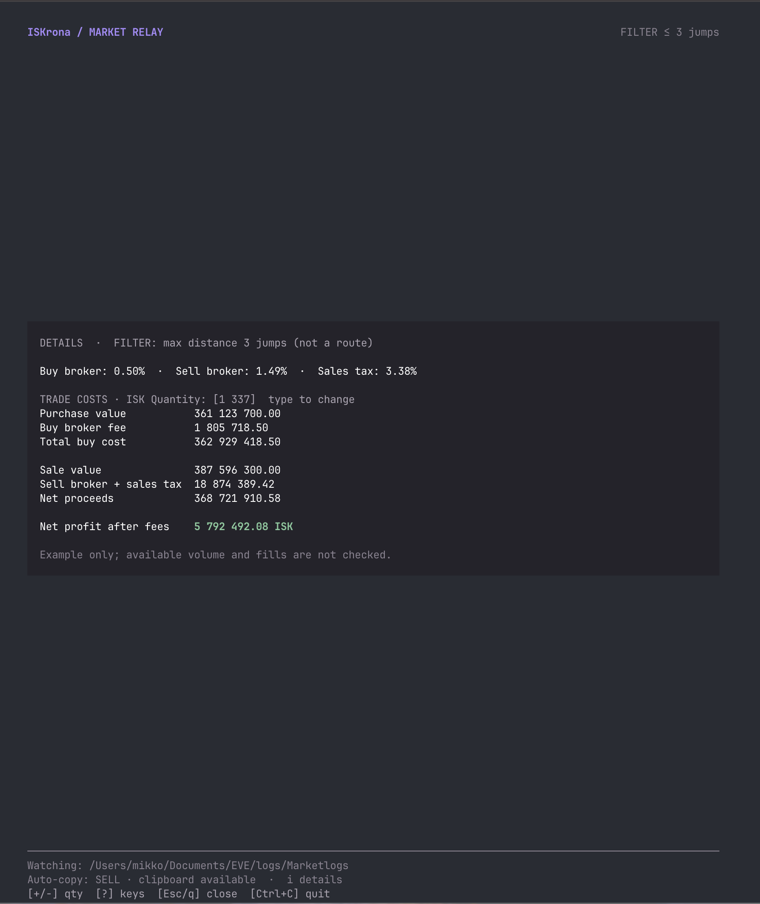

# ISKrona user guide

For the stable download and quick start, see the [README](../README.md). For source builds and offline simulation, see [Contributing](../CONTRIBUTING.md).

## Market Relay

Normal startup automatically creates missing [configuration](#configuration). Automatic folder detection checks only `Documents/EVE/logs/Marketlogs` under your home directory. If EVE uses a different location, such as a redirected Documents folder, set `market.marketlogs` or run `iskrona --path DIR`.

Bare `iskrona` opens Market Relay; `iskrona tui` is the optional explicit equivalent, with the same flags. It baselines existing files at startup and updates for new or changed `.txt` exports once stable. Press `Ctrl+C` to stop it.



Press `i` to inspect the trade cost breakdown and see how fees affect the result.

### 5% order-book depth

In builds that support 5% depth, Market Relay can show a **5% DEPTH** price alongside the best price on each side. The price is the volume-weighted average of the best 5% of eligible units: highest-priced buy orders first and lowest-priced sell orders first, using part of the last order if needed.

- The volume shown is the side's total eligible remaining units, not the size of the 5% slice.
- The jump limit applies. Buy orders priced below 10% of the best buy and sell orders priced above 10 times the best sell are excluded so very large orders far from the best price don't skew the average.
- Prices are rounded to a valid EVE tick. When both sides have depth prices, **5% MARGIN** applies the same broker fees and sales tax as **NET MARGIN**.
- Exports without `volRemaining` still show best prices and omit the depth row.

These figures come from your export and cover only orders within the jump limit. Whole-region figures from services such as EVE Tycoon can differ because they cover more orders and don't round the average to an EVE tick.

### Update checks

Release builds of Market Relay (`iskrona`, `tui`, or the deprecated `watch` alias) check GitHub's releases API for a newer stable version in the background at startup. Source builds report version `dev` and do not check for updates unless built with a release version. The request has a short timeout; offline or failed checks are silently ignored and never delay the dashboard. No market exports or EVE credentials are sent. Other commands do not check for updates.

When an update is available, the dashboard shows its version and links to [GitHub Releases](https://github.com/mekstrem/iskrona/releases). Updates are never downloaded or installed automatically; use that page to update manually.

## Commands

```text
iskrona [--path DIR] [--jumps N] [--copy buy|sell] [--no-color]
iskrona doctor
iskrona login [--station NAME_OR_ID]
iskrona logout
iskrona tui [--path DIR] [--jumps N] [--copy buy|sell] [--no-color]
iskrona version
```

- `doctor` checks local configuration, the market folder, the newest `.txt` export, and optional clipboard availability without starting the watcher.
- `login` reuses saved authorization when possible, otherwise opens EVE SSO, and populates the broker fee and sales tax from the selected character. It models Jita 4-4 by default; use `--station` for another NPC station.
- `logout` removes the EVE authorization from the operating system credential store.
- `tui` opens the interactive Market Relay dashboard and monitors a Marketlogs directory for buy, sell, margin, and profit recommendations. It requires an interactive terminal.
- `watch` remains available as a deprecated compatibility alias for `tui`.
- Run `iskrona --help` or `iskrona COMMAND --help` for the generated command reference.

ISKrona reads the `price`, `bid`, and `jumps` columns, so extra columns and column ordering in an EVE export do not matter.

### Local diagnostics

Run `iskrona doctor` for read-only checks: configuration location and settings validity, market-folder readability, parsing and order count of the newest `.txt` export, and optional clipboard availability. It makes no network or authentication requests and performs no repairs. It checks the newest export in the configured or detected folder, not an arbitrary file path.

Results are labeled `PASS`, `WARN`, or `FAIL`:

- `WARN`: missing or legacy settings, no exports, or unavailable clipboard. Missing settings use in-memory defaults and check the usual folder above; `doctor` never creates or migrates configuration.
- `FAIL`: malformed or unreadable configuration, invalid settings or an unusable market folder, or an unreadable or malformed newest export. If an export is still being written, retry after the export finishes.

Exit status is `1` if any check fails, otherwise `0` (including warnings); command misuse returns `2`.

## Configuration

The configuration is stored in your platform-specific user config directory as `iskrona/config.toml`:

- Windows: `%AppData%\iskrona\config.toml`
- macOS: `~/Library/Application Support/iskrona/config.toml`
- Linux: `$XDG_CONFIG_HOME/iskrona/config.toml`, or `~/.config/iskrona/config.toml` when unset.

```toml
[market]
marketlogs = ""
max_jumps = 0

[fees]
buy_broker = 0.005
buy_location = "structure"
broker = 0.02
sales_tax = 0.01

[display]
copy_mode = "sell"
copy_price = "best"
color = true
theme = "default"
```

`max_jumps` limits the market distance considered. Fee values are decimal fractions: `0.02` means 2%. Per-run options override the corresponding saved settings.

While Market Relay is running, press `+` to increase the distance or `-` to decrease it. The dashboard recalculates the current export immediately, uses the new limit for later exports, and saves the value as the next-run default.

Press `F2` on the dashboard to cycle through Default → Caldari (steel blue) → Gallente (jade) → Minmatar (rust) → Amarr (gold). The theme redraws immediately and is saved for the next run; existing configurations keep the original Default colors. You can also set `display.theme` to `default`, `caldari`, `gallente`, `minmatar`, or `amarr`. Profit/loss colors remain green/red in every theme, and `--no-color` (or `color = false`) disables all colors without changing the saved theme. `?` opens shortcut help. If saving fails, the previous theme stays active and an error is shown; other saved settings and per-run overrides are left unchanged.

## EVE-derived fees

On the first interactive Market Relay launch, choose EVE SSO, manual fee setup, or explicitly labelled estimates. SSO lets you choose an NPC station (Jita 4-4 by default), derives NPC sell fees from skills and standings, and asks where you place buy orders. Structure buy fees must be entered manually; choose manual setup for structure sell fees. Enter percentages as shown in EVE: for example, enter `1.47` for 1.47%. Review the rates before saving. Existing and migrated configurations are not prompted, and noninteractive commands never open setup. Cancelling leaves setup pending for the next interactive launch; a successful SSO login saves its NPC fees and authorization even if you leave before finishing buy fees.

The `fees.setup` value tracks this flow: `pending`, `estimates`, `manual`, or `eve`. Choosing estimates keeps an **INCLUDES ESTIMATED FEES** label in Market Relay. Standalone `iskrona login` preserves this state because it leaves buy fees unchanged: estimates stay labelled, and pending setup is still offered on the next interactive launch. After manually replacing remaining estimate rates in the file, set `setup = "manual"` to remove the label. `doctor` remains read-only and never starts setup.

`iskrona login` reuses saved authorization when possible; otherwise it opens your browser for EVE SSO using the local callback `http://localhost:8765/callback`. The bundled EVE client ID is public; the app registration must retain this exact callback URL.

ISKrona requests your character's skills and standings, and uses Accounting, Broker Relations, and the selected station's NPC corporation and faction standings to calculate fees. The selected station defaults to Jita IV - Moon 4 - Caldari Navy Assembly Plant. `broker` is the sell-order broker fee. `buy_location` defaults to `"structure"`; set it to `"npc"` for an NPC buy order. `buy_broker` is the total buy-order rate, defaulting to 0.5%. For structures it includes the 0.5% SCC surcharge: the structure broker component is the remaining rate, with a 100 ISK minimum per order, plus the surcharge. Rates below 0.5% remain accepted, but the full 0.5% surcharge and 100 ISK broker minimum still apply. Set the total rate to match the structure; for NPC stations enter the applicable broker percentage. Login updates `broker` and `sales_tax` from NPC data but leaves the buy settings unchanged. The margin estimates a one-unit buy order; profit examples apply the minimum once to the whole order. Rerun `iskrona login` after skills or standings change.

## Clipboard

ISKrona automatically copies the best sell recommendation when it processes an export by default. Set `display.copy_mode` or use `--copy buy` or `--copy sell` to choose the side. Press `c` to copy the configured recommendation, or `y` and `b` to copy the best sell and buy prices directly.

In builds that support [5% depth](#5-order-book-depth), press `Y` or `B` to copy the 5% sell or buy price. Set `display.copy_price = "depth"` to use depth for `c` and automatic copy; if the selected side has no depth price, nothing is copied. Set it to `"best"` (the default) to use the best price.

If clipboard initialization is unavailable, analysis continues and Market Relay shows auto-copy as disabled. Clipboard writes are best-effort because the underlying clipboard API does not report runtime write failures.

## Troubleshooting

- **`market.marketlogs is empty`**: set the Marketlogs path in the configuration file, or use `iskrona tui --path DIR`. Run `iskrona doctor` to check local settings without changing them.
- **No output for an export**: start `tui` before creating or changing the `.txt` export; unchanged files already in the directory at startup are ignored.
- **Invalid export error**: verify the export has `price`, `bid`, and `jumps` columns. If it is still being written, retry `iskrona doctor` after the export finishes.
